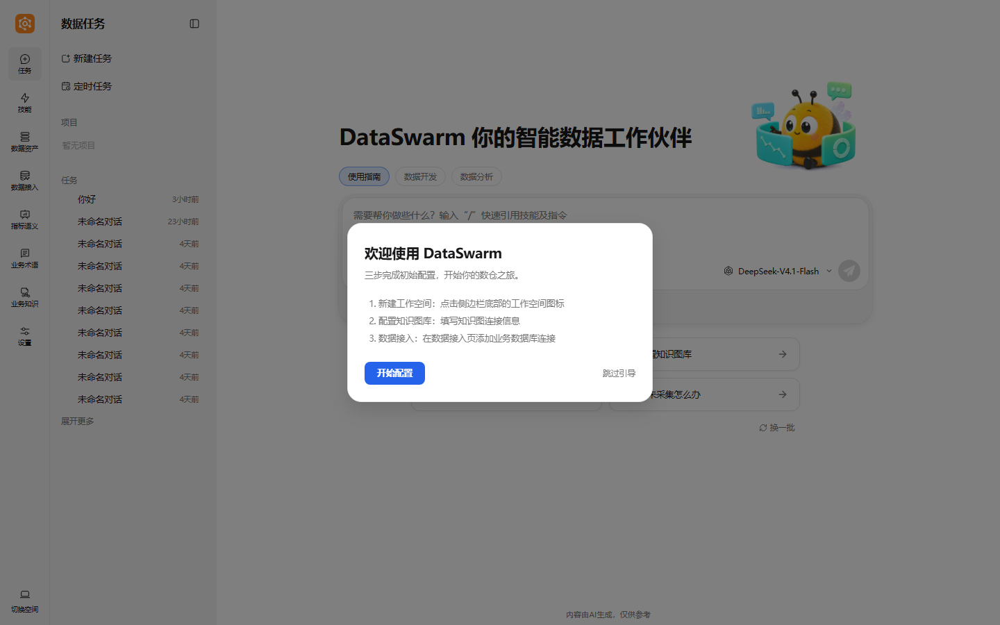
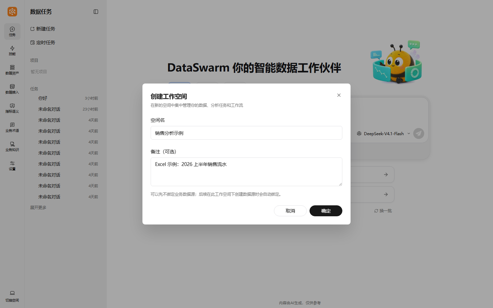
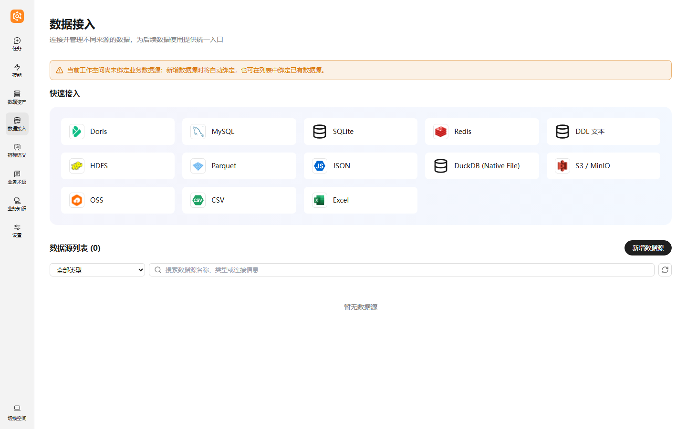
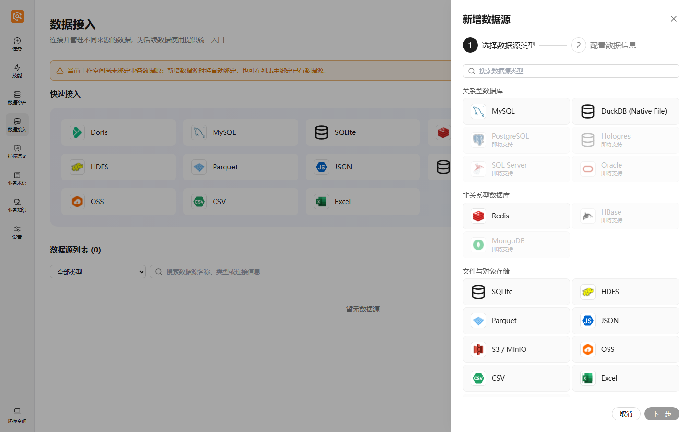
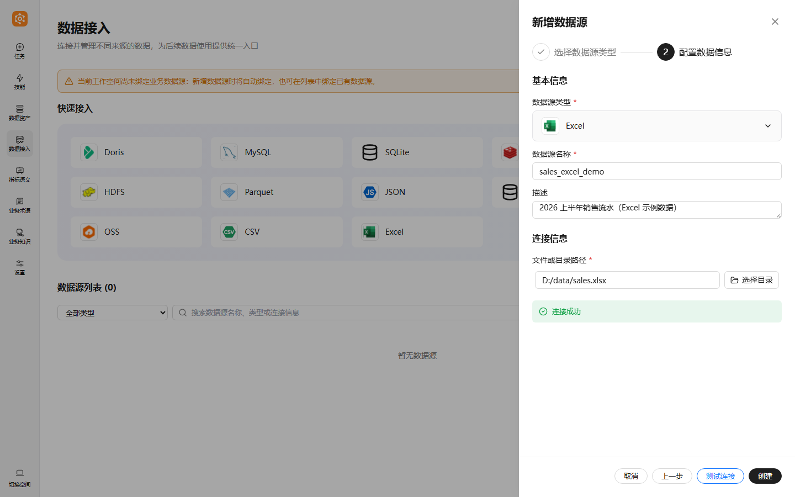
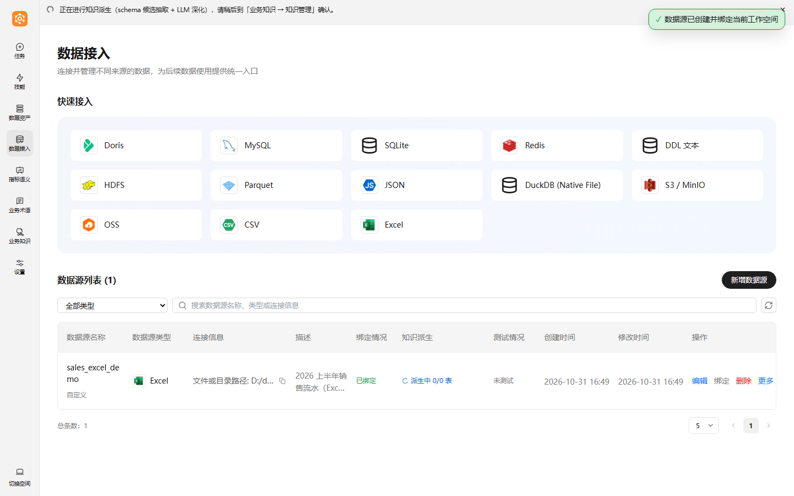
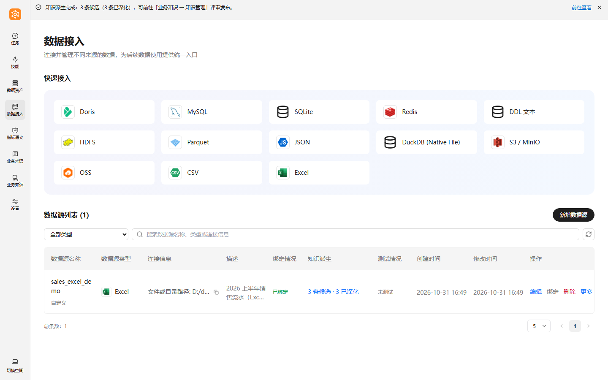
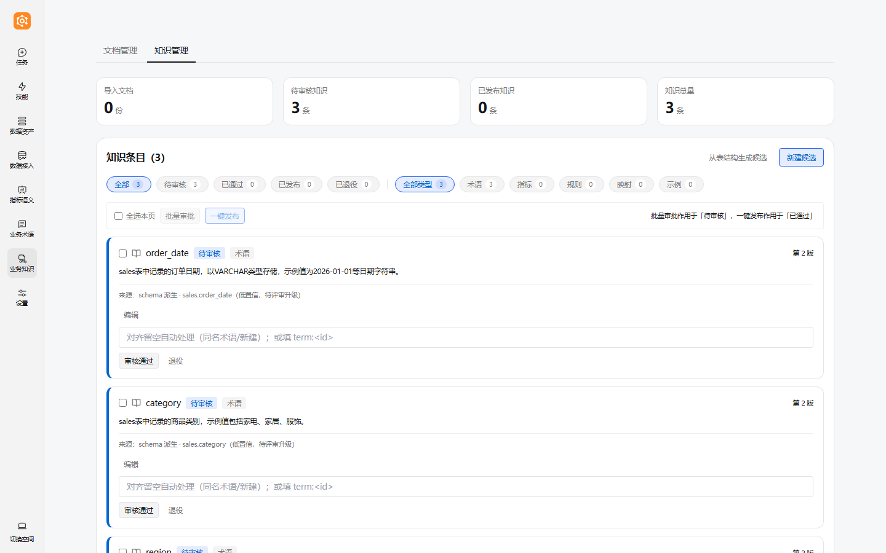
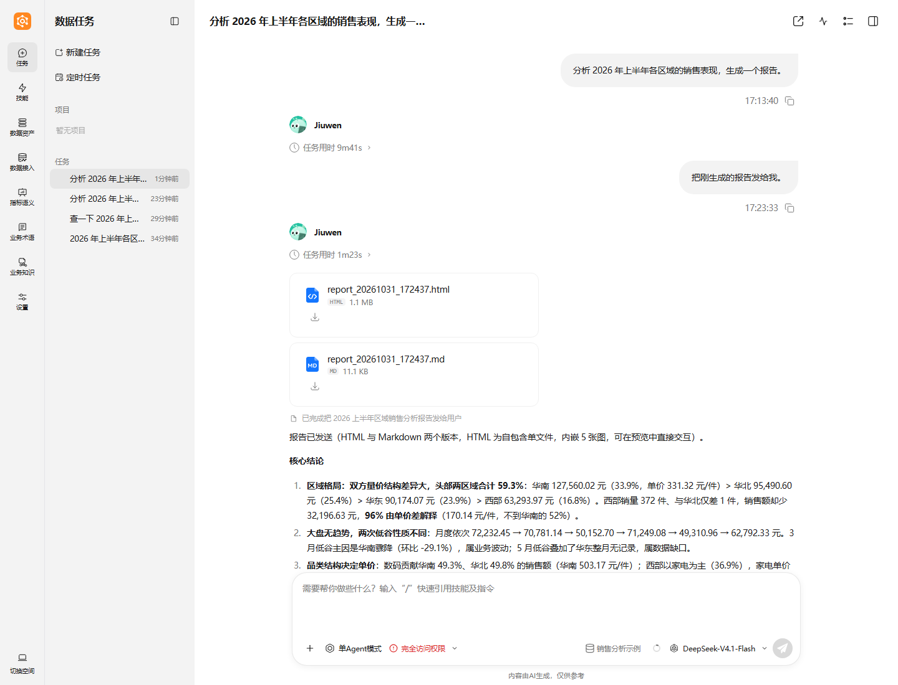

# DataSwarm 入门示例：Excel 接入 → 语义抽取 → 问数

本示例用一份 Excel 销售流水，走完 DataSwarm 的**界面主流程**：

1. 新建工作空间
2. 在「数据接入」页创建 Excel 数据源（自动绑定工作空间）
3. 等待知识派生 / 语义抽取完成
4. 在业务知识页评审候选
5. 在对话里用自然语言问数（需要完整分析时让它生成报告）

> 目标：新用户在服务启动后 30 分钟内跑通核心链路。
> 前置：DataSwarm 已按 [README 快速开始](../README.zh.md#快速开始) 组装并启动，
> 浏览器打开 <http://127.0.0.1:16173>；模型与「知识图库」已配置（见下方「常见问题」）。

## 示例数据

| 文件 | 说明 |
| --- | --- |
| [`data/sales.xlsx`](data/sales.xlsx) | 主示例：2026 年 1–6 月销售流水，77 行 |
| [`data/sales.csv`](data/sales.csv) | 同内容的 CSV 版，可用来体验 CSV 数据源 |

字段：`order_date`（订单日期）、`region`（区域：华东/华南/华北/西部）、
`category`（品类：数码/家电/家居/服饰）、`sales`（销售额）、`quantity`（数量）。

接入时填**服务端**上的绝对路径。示例命令以 `D:/data/sales.xlsx` 为例，你可以把
`examples/data/sales.xlsx` 复制到任意目录后替换路径。

## 第 0 步：新建工作空间

首次打开会看到三步引导（新建工作空间 → 配置知识图库 → 数据接入）。

点击左下角「切换空间」→「新建工作空间」，填写空间名，例如「销售分析示例」。

创建后会自动切换到新空间。数据源、会话、库表与产物都按工作空间隔离，
后续所有操作都在这个空间里进行。

## 第一步：在界面接入 Excel 数据源

点击左侧「数据接入」。页面顶部是「快速接入」卡片，下方是当前空间的数据源列表。

点击右上角「新增数据源」（或直接点快速接入区的「Excel」卡片），进入向导第一步，
在「文件与对象存储」分类下选择 **Excel**。

下一步填写连接信息：

| 字段 | 示例值 |
| --- | --- |
| 数据源名称 | `sales_excel_demo` |
| 描述 | `2026 上半年销售流水（Excel 示例数据）` |
| 文件或目录路径 | `D:/data/sales.xlsx` |

先点「测试连接」，确认出现绿色「连接成功」，再点「创建」。

「创建」会把数据源保存到当前工作空间并**自动绑定**：当前空间还没有业务数据源时
直接绑定；已有绑定时会弹出「换绑 / 不换绑仅添加」让你选择。

> 路径支持单个 `.xlsx / .xlsm / .xls` 文件，也支持一个目录：目录下每个工作簿
> 会成为一张表（表名 = 文件名去掉扩展名）。CSV 数据源同理。

## 第二步：等待知识派生 / 语义抽取

绑定成功后会自动触发知识派生（schema 候选抽取 + LLM 深化），页面顶部出现进度横幅，
数据源列表的「知识派生」列同步显示「派生中 n/m 表」。

等待任务结束，横幅变为「知识派生完成：N 条候选（M 条已深化）」，
列表列显示「N 条候选 · M 已深化」，点横幅右侧「前往查看」即可进入评审页。

失败或超时可以在列表的「知识派生」列点「重试」；LLM 深化依赖模型配置，模型不可用时
会显示失败原因。

## 第三步：评审业务知识（可选但推荐）

进入「业务知识 → 知识管理」，可以看到由表结构派生的候选（低置信，待评审）：
每条候选带着字段说明与样例值，可逐条「审核通过」或「退役」；审核通过后可对齐已有术语
或新建术语，再「一键发布」（发布作用于已通过条目）。

这一步不是问数的前置条件，但评审并发布的术语/指标会形成后续问数的权威口径；
不评审时，分析会走探索口径并在回答中注明。

## 第四步：在对话里问数

点击左侧「任务」→「新建任务」，确认输入框底部的工作空间是「销售分析示例」，
直接用自然语言提问。简单取数例如：

> 查一下 2026 年上半年各区域的销售额合计，按金额从高到低排序。

需要走完整分析链路并产出报告时，把诉求补全即可：

> 分析 2026 年上半年各区域的销售表现，生成一个报告。

Agent 会先取数、再按分析链路产出结论，最后把 HTML/Markdown 报告作为文件发回对话。
报告是自包含的单文件 HTML（图表内嵌，可直接预览/下载）和对应的 Markdown 版本。

> 截图里在报告生成后补了一句「把刚生成的报告发给我」用于展示文件卡片；
> 正常一轮对话中，报告会作为该问题的产出直接发回。

由本示例数据生成的报告可直接查看：

- [Markdown 版（在线预览）](report/sales-analysis-report.md)
- [HTML 版（自包含单文件，下载后用浏览器打开）](report/sales-analysis-report.html)

分析过程可在「分析追踪」页逐步回放（以 manifest 账本为唯一审计来源）。

## 常见问题

**路径应该填什么？**
填**服务端**（运行 DataSwarm 的机器）上的绝对路径，不是浏览器所在电脑的路径。

**知识图库必须先配置吗？**
需要。绑定数据源后的语义采集 / 语义层能力依赖知识图库：进入「设置 → 知识图库」
填写连接信息，保存后会写入仓库根 `.env`，**重启服务后生效**。

**Excel 里的多个工作表怎么办？**
当前按工作簿粒度接入，一个工作簿对应一张表；需要多表时拆成多个文件放在同一目录，
再把数据源路径指向该目录。

**想换一个数据源 / 解除绑定？**
在数据源列表中对该源点「绑定」（换绑）或「删除」；删除已绑定的源时会提示解除绑定。

**界面之外还有别的入口吗？**
`dwcli` 与 HTTP 接口主要供脚本、Agent 和自动化使用，普通用户按本文的界面流程操作即可。
命令清单见 [README 的 CLI 一览](../README.zh.md#cli-一览dwcli)。
